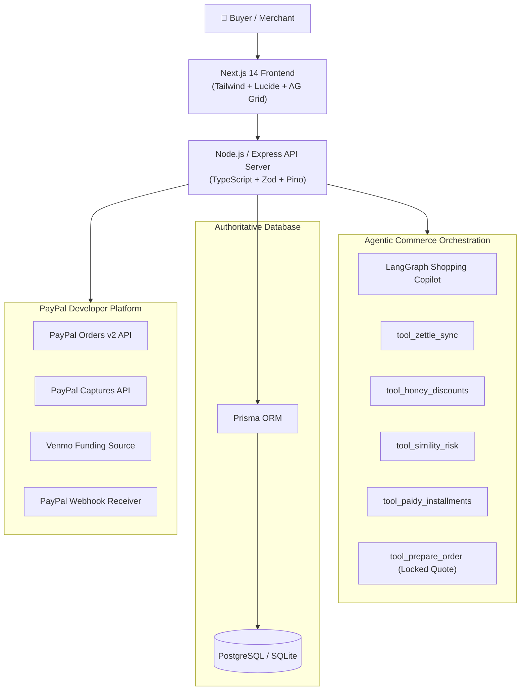

# 🚀 PayPilot AI

[](https://developer.paypal.com/)
[](https://www.ag-grid.com/)
[](https://www.apimatic.io/)
[](https://render.com/)
[](LICENSE)
[](apps/api/src/tests/api.test.ts)

> **Submission for the [PayPal AI Hackathon](https://paypalaihackathon.devpost.com/)**  
> *Zero-Trust Agentic Commerce Platform fusing multi-step AI orchestration, PayPal Honey coupon optimization, Simility AI fraud risk detection, and AG Grid enterprise telemetry with server-side PayPal Sandbox & Venmo checkout.*

---

## 🏆 Hackathon Prize Targets

- 🥇 **Grand Prize (1st Place: \$12,000 USD)**
- 🤖 **Best Use of Agentic Commerce (\$5,000 USD)**
- 🧠 **Best Use of PayPal + AI (\$5,000 USD)**
- 📊 **Best Use of AG Grid (\$5,000 USD - 1st Place Sponsor Prize)**
- 🔌 **Best Use of APIMatic (\$1,000 USD + 6mo Subscription)**
- ☁️ **Best Use of Render (\$1,000 USD Cloud Credits)**

---

## ✨ Key Features & Architecture

- 🤖 **Autonomous Agentic Auto-Pilot**: Multi-tool reasoning flow executing product discovery, stock checks, discount finding, fraud scoring, and quote generation in a single prompt.
- 🍯 **PayPal Honey Smart Coupon Engine**: Auto-discovers and tests promotional codes (`HONEY20`, `PAYPALAI`, `DEVPOST10`), computes stackable savings, and awards Honey Gold points.
- 🛡️ **PayPal Simility AI Risk Guard**: Real-time transaction fraud scoring, bot detection, and velocity checks before orders enter the PayPal sandbox.
- 🏬 **PayPal Zettle Omnichannel Sync**: Live inventory synchronization between central warehouse storage and physical retail point-of-sale locations.
- 💳 **PayPal Sandbox, Venmo & Pay in 4 Checkout**: Strict server-side order creation (`/v2/checkout/orders`), capture verification, and 4 interest-free installment calculations.
- 📊 **Enterprise AG Grid Merchant Operations Hub**: High-performance data tables for product catalogue and order tracking with instant text search, column sorting, inline stock adjustments, and one-click CSV export.
- 🔒 **Zero-Trust Financial State Machine**: Prices and stock are authoritative from PostgreSQL—never trusted from client or AI inputs.
- 📑 **APIMatic OpenAPI 3.1 & Postman Ready**: Spec file and collection ready for instant multi-language SDK generation and API testing.
- ☁️ **Render Cloud Deployment**: Production Blueprint (`render.yaml`) for 1-click cloud provisioning.

---

## 🏗️ Layer Architecture



---

## 🚀 Quickstart Guide (Run in 2 Minutes)

### 1. Prerequisites
- **Node.js**: v18+
- **npm** or **pnpm**

### 2. Installation & Setup
```bash
# Clone the repository
git clone https://github.com/rishi/paypilot-ai.git
cd paypilot-ai

# Copy environment variables
cp .env.example .env

# Install dependencies (root, backend, frontend, AG Grid, contracts)
npm install

# Push database schema & seed initial catalogue
npx prisma db push
npm run db:seed
```

### 3. Launch Development Servers
```bash
npm run dev
```

- 🛍️ **Storefront & Agentic AI Copilot**: [http://localhost:3000](http://localhost:3000)
- 📊 **Merchant Operations Hub (AG Grid)**: [http://localhost:3000/dashboard](http://localhost:3000/dashboard)
- ⚡ **Backend API & Health**: [http://localhost:5000/health](http://localhost:5000/health)

---

## 🧪 Automated Testing

PayPilot AI includes a comprehensive automated test suite testing Agentic Commerce workflows, PayPal orders, Simility risk assessment, Honey coupons, and idempotency:

```bash
npm run test --prefix apps/api
```
```text
 ✓ GET /health should return service status
 ✓ GET /api/products should return seeded catalogue list
 ✓ GET /api/products/compare should return comparison table
 ✓ POST /api/ai/chat should process budget query and suggest tools
 ✓ POST /api/ai/chat should execute full Agentic Commerce workflow (Honey + Simility + Zettle)
 ✓ POST /api/ai/chat should process Venmo bill-split request
 ✓ POST /api/ai/chat should calculate international FX rates via PayPal Xoom
 ✓ PayPal Venmo Split Engine should calculate per-person shares and deep links
 ✓ PayPal Braintree Vault Engine should simulate tokenization and 3DS2 liability shift
 ✓ PayPal Xoom FX Engine should calculate converted currencies and guaranteed rate locks
 ✓ PayPal Swift Financial Engine should calculate pre-approved working capital advances
 ✓ PayPal Hyperwallet Disbursement Engine should calculate 95% merchant payout split
 ✓ PayPal Simility AI Risk Engine should evaluate risk score and bot signatures
 ✓ PayPal Honey Coupon Engine should auto-discover and calculate maximal savings
 ✓ PayPal Pay in 4 / Paidy BNPL should calculate interest-free installments
 ✓ PayPal Zettle Omnichannel POS Sync should report physical & online stock
 ✓ POST /api/ai/chat should enforce security guardrails on bypass attempts
 ✓ End-to-End Order Creation & PayPal Sandbox Payment Capture
 ✓ POST /api/webhooks/paypal should handle events idempotently

 Test Files  1 passed (1)
      Tests  19 passed (19)
```

---

## 🧰 Hackathon Sponsor Tools Documentation

- 📊 **AG Grid Integration**: Fully integrated in the Merchant Operations Hub (`apps/web/src/app/dashboard/page.tsx`).
- 🔌 **APIMatic Guide & SDK Generation**: See [docs/APIMATIC_GUIDE.md](docs/APIMATIC_GUIDE.md) and [docs/openapi.yaml](docs/openapi.yaml).
- ☁️ **Render Cloud Deployment**: See [docs/RENDER_DEPLOYMENT.md](docs/RENDER_DEPLOYMENT.md) and [render.yaml](render.yaml).
- 📬 **Postman Test Collection**: See [docs/postman_collection.json](docs/postman_collection.json).
- 🎬 **Devpost Submission & 3-Min Video Script**: See [docs/devpost-submission.md](docs/devpost-submission.md).

---

## 📄 License
This project is open-source and licensed under the **[MIT License](LICENSE)**.
