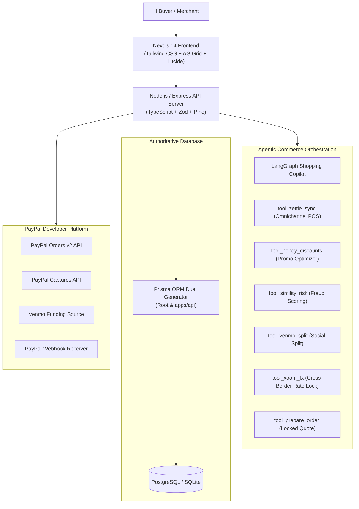

# 🚀 PayPilot AI

[](https://developer.paypal.com/)
[](https://www.ag-grid.com/)
[](https://www.apimatic.io/)
[](https://render.com/)
[](LICENSE)
[](apps/api/src/tests/api.test.ts)

[](https://render.com/deploy?repo=https://github.com/rishi925-eng/paypilot-ai)

> *Enterprise Zero-Trust Agentic Commerce Platform orchestrating multi-step AI copilot flows, PayPal Honey coupon optimization, Simility AI fraud risk heuristics, Venmo social bill-splits, Xoom multi-currency FX rate locks, and AG Grid enterprise telemetry with server-side PayPal Sandbox & Pay in 4 checkout.*

---

## 💡 Why PayPilot AI? (The Core Problem & Solution)

Traditional online commerce is plagued by high friction, fragmented toolchains, and rising checkout abandonment:
- **Coupon drop-offs**: Shoppers waste up to 15 minutes hunting for expired coupon codes across external sites.
- **Split payment headaches**: Coordinating group purchases and splitting bills with friends across multiple apps causes cart drop-off.
- **Checkout fraud & price tampering**: Merchants lose billions to client-side price tampering, coupon manipulation, and bot attacks.
- **Disconnected retail & warehouse inventory**: Physical POS stock and online warehouse databases frequently fall out of sync.

**PayPilot AI** solves this by unifying autonomous AI orchestration with the complete **PayPal Developer Platform**:
1. **Agentic Copilot**: Finds verified items, auto-applies verified Honey discounts, and generates locked quotes.
2. **Zero-Trust Pricing**: Every cent, tax, and discount is cryptographically calculated and enforced server-side.
3. **Simility AI Fraud Detection**: Evaluates risk and bot heuristics in real-time before transactions touch the payment gateway.
4. **Venmo & Xoom Integrations**: Native social bill-splitting and guaranteed multi-currency exchange rate locks.
5. **AG Grid Merchant Hub**: High-throughput catalog management with instant search, inline POS stock updates, and 1-click audit exports.

---

## ✨ Key Features & PayPal Suite Integration

- 🤖 **Autonomous Agentic Copilot (`/copilot`)**: Dedicated, full-page AI copilot executing catalogue discovery, live stock verification, promo code tests, fraud checks, and locked order quotes in a single conversational prompt.
- 🍯 **PayPal Honey Smart Coupon Engine**: Auto-discovers and validates promotional discount codes (`HONEY20`, `PAYPALAI`, `DEVPOST10`), computes stackable savings, and awards Honey Gold rewards.
- 🛡️ **PayPal Simility AI Risk Guard**: Real-time fraud scoring, bot detection, and velocity analysis before orders enter the PayPal sandbox.
- 🏬 **PayPal Zettle Omnichannel Sync**: Live inventory ledger synchronization between central warehouse storage and physical retail point-of-sale locations.
- 👥 **Venmo Social Bill-Split**: Automatically calculates equal/proportional per-person shares with 1-click Venmo deep links.
- 🌍 **PayPal Xoom Cross-Border FX**: Transparent international currency conversions with guaranteed rate locks and zero surprise conversion fees.
- 💳 **Server-Authoritative PayPal Checkout (`/checkout`)**: Strict server-side order creation (`/v2/checkout/orders`), capture verification, and 4 interest-free installment calculations.
- 📊 **Enterprise AG Grid Merchant Operations Hub (`/dashboard`)**: Sub-millisecond text search, multi-column sorting, inline stock adjustments synced with retail POS, and 1-click CSV financial audit exports.
- 🔒 **Zero-Trust Financial State Machine**: Prices and discounts are cryptographically authoritative from the database—never trusted from client or AI inputs.
- 🧾 **Official Printable Tax Invoices & Instant Refunds (`/orders/[id]`)**: Generates audit-compliant tax invoices with an autonomous AI dispute resolution and instant sandbox refund engine.
- 📑 **APIMatic OpenAPI 3.1 Ready**: Fully compliant OpenAPI 3.1 specification for instant multi-language SDK generation.
- ☁️ **Render Cloud Deployment**: Production Blueprint (`render.yaml`) for 1-click cloud provisioning.

---

## 🗺️ Application Routes & Architecture

All features use **dedicated page routing** with zero modal traps, zero screen-blur filters, and smooth natural scrolling:

| Route | Feature Description | Core Capabilities |
| :--- | :--- | :--- |
| **`/`** | Storefront Landing | Hero discovery, featured hardware, trust pillars & live metrics |
| **`/copilot`** | AI Shopping Copilot Pro | Full-page conversation, speech-to-text, audio replies & locked quotes |
| **`/products`** | Products Catalogue | Category filters, rating filters, price sorting & quick comparison |
| **`/products/[slug]`** | Product Detail Page | High-res imagery, technical specifications & instant cart addition |
| **`/deals`** | Flash Deals Hub | Active discounts with auto-applied Honey coupons |
| **`/cart`** | Authoritative Shopping Cart | Subtotal calculation, discount audit & checkout transfer |
| **`/checkout`** | PayPal Sandbox Checkout | Server-side PayPal buttons, Venmo funding & Pay in 4 |
| **`/orders`** | Orders History Ledger | Real-time order tracking, statuses & invoice access |
| **`/orders/[id]`** | Official Tax Invoice & Refunds | Printable receipt & AI dispute instant refund concierge |
| **`/dashboard`** | AG Grid Operations Hub | Live catalogue data grid, inline stock editing & CSV export |
| **`/login`** | User Sign In | Role-based authentication & 1-click demo profiles |
| **`/signup`** | User Registration | Customer and Merchant account creation |
| **`/wishlist`** | Customer Wishlist | Persistent saved items |
| **`/about`** | Architecture & Security | System diagrams, trust certifications & PayPal integrations |
| **`/api-docs`** | APIMatic & OpenAPI Reference | Interactive endpoint explorer & SDK download links |

---

## 🏗️ Layer Architecture



---

## ⚡ Judge 1-Click Interactive Demo Tour

A floating, minimized quick-tour bar is accessible at the bottom of the application with 7 pre-configured judge scenarios:

1. **⚡ Scenario 1: Auto-Pilot (Honey + Simility)** → Routes to `/copilot` executing multi-step discount hunting and fraud scoring for Sony headphones.
2. **👥 Scenario 2: Venmo Social Split** → Routes to `/copilot` calculating per-person payment shares with Venmo deep links.
3. **🔒 Scenario 3: Zero-Trust Security Guard** → Attempts prompt-injection price tampering to demonstrate server-side 403 attack defense.
4. **🌍 Scenario 4: Xoom FX Multi-Currency** → Routes to `/copilot` converting order pricing to Euros with guaranteed rate lock.
5. **🧾 Scenario 5: Tax Invoice & Instant Refund** → Routes to `/orders/cmwddr601004o9cvq6h44yz6w` displaying official printable invoice and 1-click refund concierge.
6. **📊 Scenario 6: Operations Hub** → Routes to `/dashboard` opening the enterprise AG Grid inventory ledger.
7. **👤 Scenario 7: Switch User** → Routes to `/login` for seamless switching between Shopper and Merchant admin roles.

---

## 🚀 Quickstart Guide (Run in 2 Minutes)

### 1. Prerequisites
- **Node.js**: v18+ or v20+
- **npm** or **pnpm**

### 2. Installation & Setup
```bash
# Clone the repository
git clone https://github.com/rishi925-eng/paypilot-ai.git
cd paypilot-ai

# Copy environment variables
cp .env.example .env

# Install dependencies (workspaces: root, api, web, contracts)
npm install

# Push database schema & seed initial catalogue
npx prisma db push
npm run db:seed

# Build contracts, backend, and frontend
npm run build
```

### 3. Launch Development Servers
```bash
npm run dev
```

- 🛍️ **Storefront & Copilot**: [http://localhost:3000](http://localhost:3000)
- 🤖 **Dedicated AI Copilot**: [http://localhost:3000/copilot](http://localhost:3000/copilot)
- 📊 **Merchant Operations Hub (AG Grid)**: [http://localhost:3000/dashboard](http://localhost:3000/dashboard)
- ⚡ **Backend API & Health**: [http://localhost:5000/health](http://localhost:5000/health)

---

## 🧪 Automated Testing (20 / 20 Tests Passing)

PayPilot AI includes a comprehensive Vitest integration test suite testing all agentic commerce flows, PayPal orders, Simility fraud scoring, Honey coupons, and idempotency:

```bash
npm test --prefix apps/api
```

```text
 ✓ GET /health should return service status
 ✓ GET /api/products should return seeded catalogue list
 ✓ GET /api/products/compare should return comparison table
 ✓ POST /api/ai/chat should process budget query and suggest tools
 ✓ POST /api/ai/chat should execute full Agentic Commerce workflow (Honey + Simility + Zettle)
 ✓ POST /api/ai/chat should process Venmo bill-split request
 ✓ POST /api/ai/chat should calculate international FX rates via PayPal Xoom
 ✓ PayPal Venmo Split Engine should calculate per-person shares and deep links
 ✓ PayPal Braintree Vault Engine should simulate tokenization and 3DS2 liability shift
 ✓ PayPal Xoom FX Engine should calculate converted currencies and guaranteed rate locks
 ✓ PayPal Swift Financial Engine should calculate pre-approved working capital advances
 ✓ PayPal Hyperwallet Disbursement Engine should calculate 95% merchant payout split
 ✓ PayPal Simility AI Risk Engine should evaluate risk score and bot signatures
 ✓ PayPal Honey Coupon Engine should auto-discover and calculate maximal savings
 ✓ PayPal Pay in 4 / Paidy BNPL should calculate interest-free installments
 ✓ PayPal Zettle Omnichannel POS Sync should report physical & online stock
 ✓ POST /api/ai/chat should enforce security guardrails on bypass attempts
 ✓ End-to-End Order Creation & PayPal Sandbox Payment Capture
 ✓ POST /api/webhooks/paypal should handle events idempotently
 ✓ POST /api/auth/register & /login should handle end-to-end user authentication

 Test Files  1 passed (1)
      Tests  20 passed (20)
   Duration  710ms
```

---

## 🧰 Enterprise Ecosystem & Developer Documentation

- 📊 **AG Grid Integration**: Integrated in the Merchant Operations Hub (`apps/web/src/app/dashboard/page.tsx`) with fast text filtering, column pinning, sorting, and CSV export.
- 🔌 **APIMatic Guide & SDK Generation**: See [docs/APIMATIC_GUIDE.md](docs/APIMATIC_GUIDE.md) and [docs/openapi.yaml](docs/openapi.yaml).
- ☁️ **Render Cloud Deployment**: Fully provisioned via [render.yaml](render.yaml) Blueprint Infrastructure-as-Code.
- 📬 **Postman Test Collection**: Pre-configured in [docs/postman_collection.json](docs/postman_collection.json).
- 🎬 **Product Presentation Guide & 3-Min Video Pitch Script**: Complete product-only presentation walkthrough in [docs/devpost-submission.md](docs/devpost-submission.md).

---

## 📄 License

This project is open-source and licensed under the **[MIT License](LICENSE)**.
