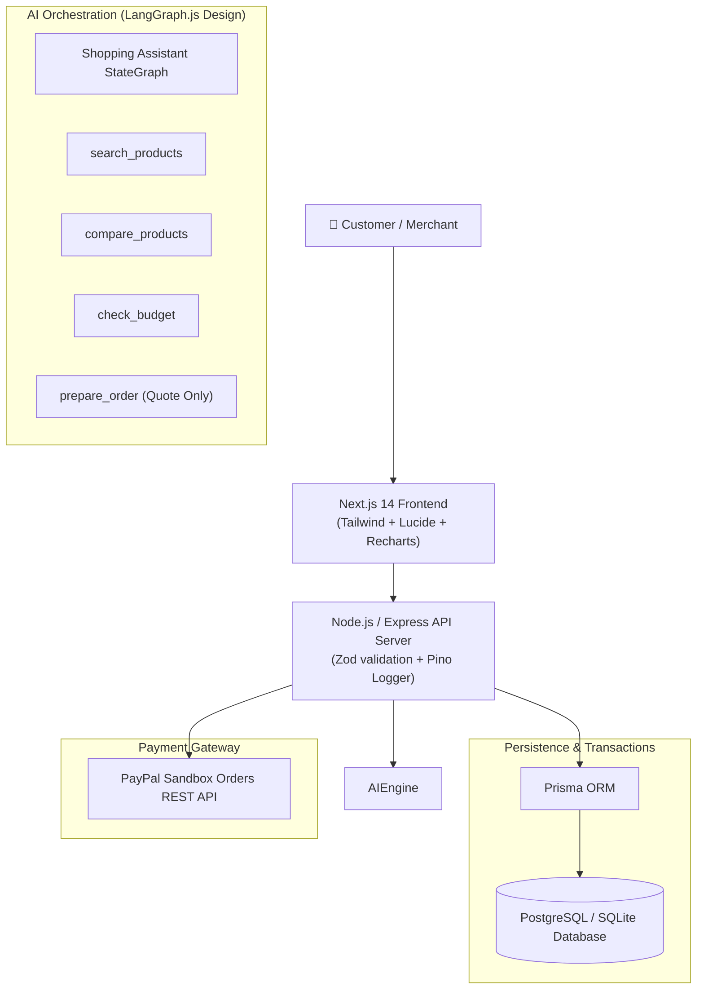

# PayPilot AI — Architectural Specification

## 1. System Philosophy
PayPilot AI couples flexible open-source AI orchestration with resilient payment engineering. All user-facing AI recommendations are validated against authoritative database state, ensuring that LLMs can never unilaterally alter monetary prices, deplete inventory without reservation, or mark an uncaptured payment as successful.

---

## 2. Layer Topology

---

## 3. Financial Integrity & Zero-Trust State Machine
- Prices are retrieved directly from the `Product` table during checkout calculations.
- Direct price overrides in API payloads or AI prompt contexts are rejected by Zod schema validation.
- Inventory is decremented automatically upon verified payment capture via database transaction.
